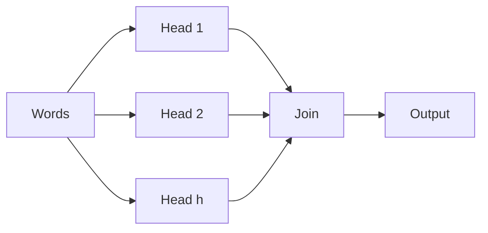

# Example answers

The same question at three levels: "How does multi-head attention work?" Sources: `[1]` §3.2.1
Scaled dot-product attention (p. 4), `[2]` §3.2.2 Multi-head attention (p. 4–5), `[3]` Figure 2
caption (p. 4). These are the renderer's visual test fixtures.

## Beginner

Imagine reading a sentence and asking several questions about each word at once: *who did it?*,
*to whom?*, *when?* Multi-head attention lets the model do exactly that, many "looks" in parallel [2].

Each look is one **attention head**. A head compares every word with every other word and decides
how much each one matters, then mixes the words together using those weights [1].

:::key-idea
Several small attention heads looking at different relationships work better than one big one [2].
:::

The paper uses 8 heads [2].

:::general
"Attention" in everyday machine-learning talk just means a learned weighting of inputs.
:::

## Intermediate

**Intuition.** One attention function averages over all positions, which blurs different kinds of
relationships together. Multi-head attention runs several attention functions in parallel on
different learned projections, so each can focus on something different [2].

**Mechanism.** Queries, keys and values are projected $h$ times with separate matrices
$W_i^Q, W_i^K, W_i^V$; each head computes scaled dot-product attention; the outputs are
concatenated and projected once more with $W^O$ [2][3].

$$\text{head}_i = \text{Attention}(QW_i^Q,\; KW_i^K,\; VW_i^V)$$

$$\text{Attention}(Q,K,V) = \operatorname{softmax}\!\left(\frac{QK^\top}{\sqrt{d_k}}\right)V$$

The $\sqrt{d_k}$ keeps dot products from growing so large that softmax saturates [1].

:::key-idea
Same total cost, more kinds of attention: with $h = 8$ and $d_k = d_v = d_{model}/h = 64$, the heads
together cost about as much as one full-size head [2].
:::

## Expert

$\text{MultiHead}(Q,K,V) = \text{Concat}(\text{head}_1,\dots,\text{head}_h)W^O$ with
$\text{head}_i = \text{Attention}(QW_i^Q, KW_i^K, VW_i^V)$, $h = 8$, $d_k = d_v = 64$ [2]. Reduced
per-head dimensionality keeps cost close to single-head attention at full width [2]; scaling by
$1/\sqrt{d_k}$ counters softmax saturation for large $d_k$ [1].

:::note
Figure 2 shows the $h$ parallel attention layers between the projections and the final linear layer [3].
:::

:::general
Later work found many heads can be pruned with little loss, suggesting redundancy across heads.
:::
